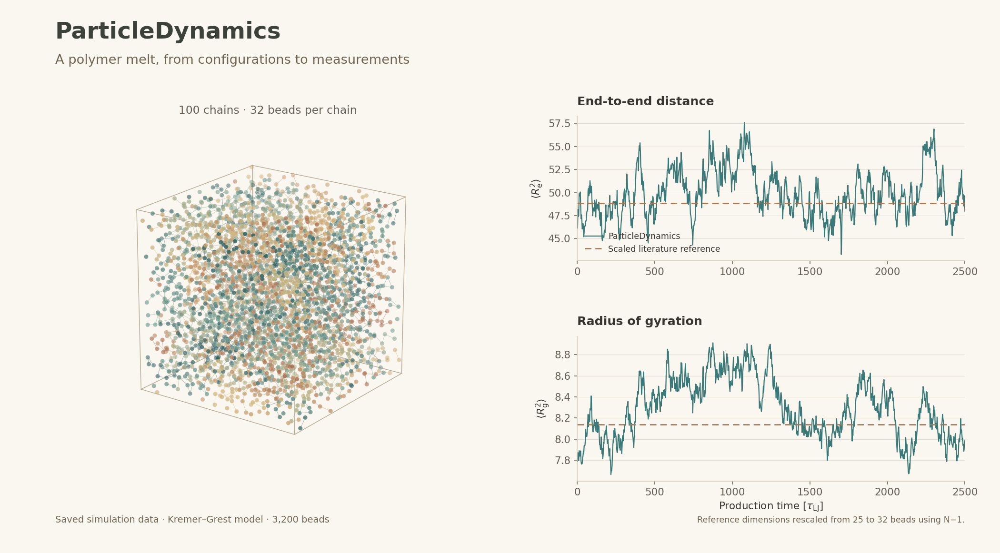

# Examples

Choose a physical system, run the script, then adapt its forces, methods and
measurements. Each example lives in the repository's `examples/` directory.

## Run an example

Use a checkout of the repository so the scripts and package version match:

```sh
git clone https://github.com/amirabbasi-physics/ParticleDynamics.jl.git
cd ParticleDynamics.jl
julia --project -e 'using Pkg; Pkg.instantiate()'
```

Then run a script from the repository root. The examples require a working
CUDA-capable NVIDIA GPU and write their output beside the scripts. Re-running
a script can replace its previous output.

## Fluids

### A Lennard-Jones fluid in NVE

Follow a three-dimensional fluid without a thermostat. This is a useful
starting point for checking total-energy conservation and choosing a timestep.

```sh
julia --project examples/3D_LJ_NVE.jl
```

The default system has 4,000 particles at reduced density 0.8. Initial
velocities have zero centre-of-mass velocity and a prescribed kinetic
temperature. The run writes `traj3d_lj_nve.gsd` and `traj3d_lj_nve.log`,
including kinetic, potential and total energy.

For a short first run, keep the default system size and reduce the step count:

```sh
SIM_MAX_STEPS=1000 SIM_LOG_INTERVAL=100 julia --project examples/3D_LJ_NVE.jl
```

[Read the complete NVE script](https://github.com/amirabbasi-physics/ParticleDynamics.jl/blob/master/examples/3D_LJ_NVE.jl).
Try halving `SIM_DT` and compare the total-energy fluctuations.

### Brownian particles in 3D

Explore overdamped dynamics with WCA repulsion and thermal noise:

```sh
SIM_NPARTICLES=1000 SIM_MAX_STEPS=1000 julia --project examples/3D_BD.jl
```

This script uses Euler–Maruyama integration and writes `obs3d_bd.csv` and
`traj3d_bd.gsd`. Its full default run uses 40,000 particles. In overdamped
dynamics, focus on configurations, potential energy and transport rather
than interpreting kinetic temperature as an inertial bath temperature.

[Read the Brownian script](https://github.com/amirabbasi-physics/ParticleDynamics.jl/blob/master/examples/3D_BD.jl).

## Polymers

Start with bonded chains in 2D, then move to a 3D melt:

```sh
julia --project examples/2D_polymer_bonded.jl
julia --project examples/3D_polymer_melt.jl
```

These examples show how to supply connectivity through `Topology` and combine
bonded and nonbonded forces. Read the
[bonded-interaction guide](manual/bonded_minimization_npt.md) before changing
bond parameters or the timestep.

| Script | Explore |
|:--|:--|
| [2D bonded polymer](https://github.com/amirabbasi-physics/ParticleDynamics.jl/blob/master/examples/2D_polymer_bonded.jl) | Chain connectivity with FENE or harmonic bonds |
| [3D polymer melt](https://github.com/amirabbasi-physics/ParticleDynamics.jl/blob/master/examples/3D_polymer_melt.jl) | Many interacting chains in a periodic volume |
| [Kremer–Grest showcase](https://github.com/amirabbasi-physics/ParticleDynamics.jl/blob/master/examples/3D_KG_melt_showcase.jl) | A longer, specialized production and rendering recipe |



The showcase produces a 100-chain, 3,200-bead trajectory with chain dimensions
and bond-length measurements. The figure above plots a saved configuration
and recorded chain dimensions; the published 25-bead reference dimensions
are rescaled to 32 beads using N−1.
The [rendering instructions](https://github.com/amirabbasi-physics/ParticleDynamics.jl/blob/master/examples/README.md#kremer--grest-showcase-movie)
explain how to turn a saved trajectory into a Fresnel movie. Rendering needs
its own environment and is separate from running the simulation.

## Active particles

An Ornstein–Uhlenbeck process supplies a force with a finite correlation time.
The examples separate this active forcing from thermal white noise, so you can
study each contribution to the motion.

| Example | Question to explore |
|:--|:--|
| [Active Brownian particles](https://github.com/amirabbasi-physics/ParticleDynamics.jl/blob/master/examples/2D_active_OU_brownian.jl) | How does correlated forcing change interacting-particle motion? |
| [Free-particle MSD](https://github.com/amirabbasi-physics/ParticleDynamics.jl/blob/master/examples/2D_active_OU_brownian_free_msd.jl) | Where does persistent motion cross over to diffusion? |
| [Active and thermal forcing](https://github.com/amirabbasi-physics/ParticleDynamics.jl/blob/master/examples/2D_active_thermal_OU_brownian.jl) | What changes when a thermal bath is added? |
| [Multiple persistence times](https://github.com/amirabbasi-physics/ParticleDynamics.jl/blob/master/examples/2D_active_multi_OU_brownian_free_msd.jl) | How does a spectrum of correlation times affect displacement? |

```sh
julia --project examples/2D_active_OU_brownian_free_msd.jl
```

Use the free-particle examples to establish a reference before adding interactions.
See [dynamics](manual/integrators.md) and [observables](manual/observables.md)
for the corresponding workflow objects.

## Driven mixtures

Give two particle types separate Langevin baths, then measure each group's
thermodynamics and collision rates:

```sh
julia --project examples/TwoT_LJ2D_LD.jl
```

[Read the two-temperature script](https://github.com/amirabbasi-physics/ParticleDynamics.jl/blob/master/examples/TwoT_LJ2D_LD.jl).
For a single-temperature molecular-dynamics example with stochastic velocity
rescaling, use
[`SingleT_2D_MD_CSVR.jl`](https://github.com/amirabbasi-physics/ParticleDynamics.jl/blob/master/examples/SingleT_2D_MD_CSVR.jl).

## Machine-learned potentials

The repository also contains separate MACE and Orb integrations with their own
environments and model requirements:

- [MACE examples and setup](https://github.com/amirabbasi-physics/ParticleDynamics.jl/blob/master/examples/mace/README.md): silicon melt/quench and water structure.
- [Orb examples and setup](https://github.com/amirabbasi-physics/ParticleDynamics.jl/blob/master/examples/orb/README.md): benzene lattice energy and molecular dynamics.

Follow those setup instructions before running the scripts; they require
additional dependencies beyond the core package.
